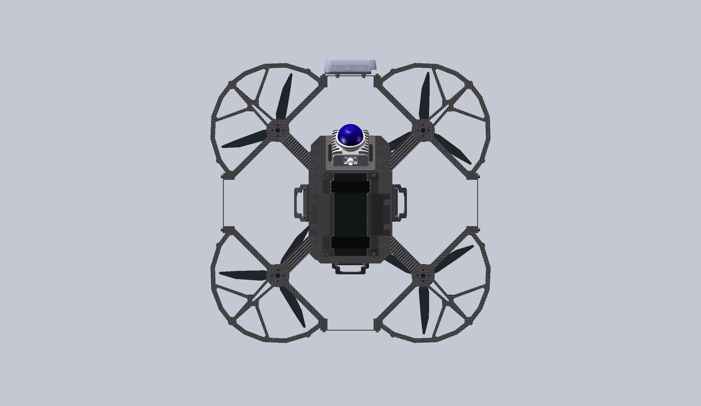
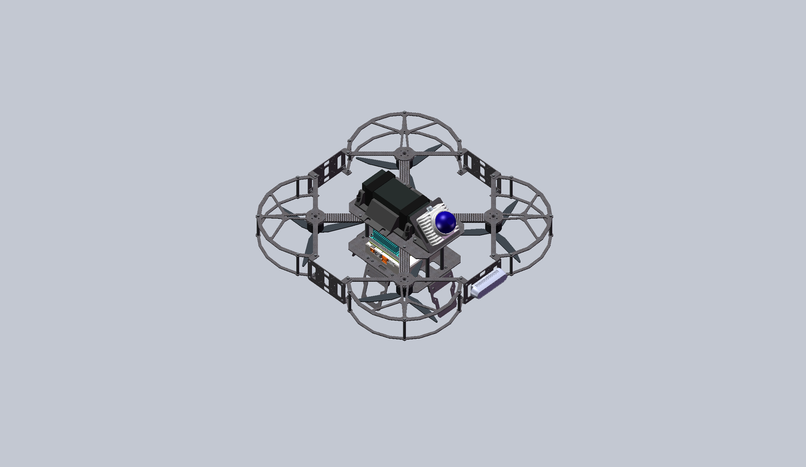
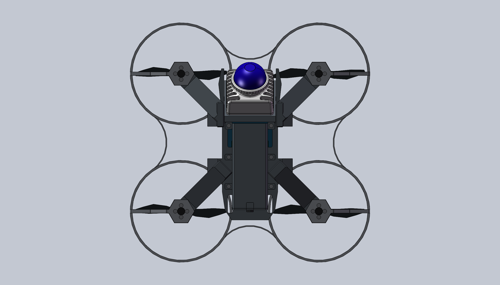
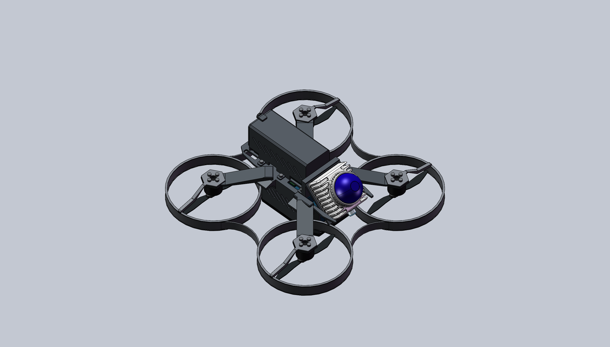

# Quadcopter Models

四旋翼无人机的 SolidWorks 机械设计：早期 **9–10 寸平台**、**KESTREL Q8（红隼）**，**KESTREL Q8 Lite**，以及 **SCALLOP Q5（扇贝）**。

## 9–10 寸平台 · 初代设计

这是一款个人设计研发的400mm轴距四旋翼全保护无人机，适用于全国大学生电子设计竞赛。

以 `9寸桨叶400轴距机架.SLDASM` 为主装配体的早期平台，采用独立机臂、上下中心板、分层桨保与下部设备支撑结构。它也是后续 Q8 在桨保轮廓、辐条过渡和设备安装方面的设计参考。

| 俯视图 | 左上方 45° 视图 |
| :---: | :---: |
|  |  |

主装配体：[9寸桨叶400轴距机架.SLDASM](9-10寸/9寸桨叶400轴距机架.SLDASM)

## KESTREL Q8 · 8 寸平台

KESTREL Q8 是面向电赛应用的 **8 寸三叶桨四旋翼平台**。以碳纤维板、标准 M3 铝柱和 FDM 打印件构建机架，围绕机载计算、感知设备与检修空间安排布局。

- **动力与桨保**：T-Motor 2810 电机倒置安装；每个旋翼采用约 180° 几何裁切桨保，上下两片通过三根 50 mm M3 铝柱连接，旋翼下方敞开。
- **计算与供电**：Jetson AGX Orin 安装在方形托板上，上层放置 5300 mAh 6S 电池；电池侧鞍和灰色斜切镂空侧罩兼顾造型、接口及散热空间。
- **感知布局**：前后 MID360 朝下 45° 安装，左右设可调角度 USB 相机托板，机头安装 RealSense D435i；飞控使用 Pixhawk 4 参考模型。
- **吊舱与维护**：下部侧板延伸为支脚，底板设检修口；为后续约 80 × 60 mm 路由器保留空间，具体高度与接线布局待实际设备确定。

| 俯视图 | 左上方 45° 视图 |
| :---: | :---: |
|  |  |

主装配体：[Q8_8寸四旋翼.SLDASM](8寸-电赛/KESTREL_Q8/Q8_8寸四旋翼.SLDASM)

### KESTREL Q8 Lite · 轻量布局

Q8 Lite 延用 Q8 的机臂、桨保、标准件及设备参考，保留完整款作为独立装配。相较 Q8，主要调整为：

- **降低上层堆叠**：AGX Orin 移入下部吊舱，拆除原上层支架；电池与单个 MID360 改放上甲板，雷达靠前、向机头上方 45° 安装，电池靠后并横滚 90° 放置。
- **重排吊舱**：100 mm 铝柱固定在甲板前后，飞控与电调叠放；保留原中央 X 主板，使用独立专用甲板及底板。
- **精简相机与支脚**：移除两侧钢索相机，增加底部对地 USB 相机并保留机头 D435i；复用长侧板，通过连接座向外倾斜 15° 作为支脚。

| 俯视图 | 左上方 45° 视图 |
| :---: | :---: |
|  |  |

Lite 主装配体：[Q8L_KESTREL_Q8_Lite.SLDASM](8寸-电赛/KESTREL_Q8/Q8L_KESTREL_Q8_Lite.SLDASM)

## SCALLOP Q5 · 扇贝

**SCALLOP Q5** 是这款 5 寸平台的名称与型号；SCALLOP 意为“扇贝”，呼应四个护圈与相邻内凹弧形成的扇贝状轮廓。

5 寸双叶柔性折叠桨四旋翼，采用镁合金 CNC 一体机身、倾斜机臂与条状下机舱，对角轴距约 **265.9 mm**。

- **动力与护圈**：T-Motor F60 Pro V-LV 电机倒置安装；银灰色 PA12 四护圈通过内凹相切弧连接成一体，主壁 1.6 mm，护圈与机舱保留约 1.0–1.8 mm 间隙。桨保按暂定材料密度估重约 72 g。
- **机身与机舱**：机臂末端下沉 10 mm，六边形电机台；根部设置 R12 加强过渡与 C1 倒角。机舱前端敞开，侧壁采用 45° 平行短通风槽，底部为带防滑槽的橡胶垫。
- **设备布局**：香橙派 5 位于下机舱，接口朝前；飞控电调一体板倒置贴顶，单个 MID360 位于机头，以 45° 支架安装。
- **后方换电**：电池占位为 110 × 43 × 45 mm，使用独立通风电池仓和手拧后盖，保留扎带孔。6S 3000 mAh 容量须按实际电池核实；接触式供电仅预留位置，触点尚未选型。

| 俯视图 | 左上方 45° 视图 |
| :---: | :---: |
|  |  |

主装配体：[Q5_KESTREL_Q5_Lite.SLDASM](5寸/KESTREL_Q5_Lite/Q5_KESTREL_Q5_Lite.SLDASM)

已检查装配引用、配合、结构干涉、桨盘扫掠及换电通道。折叠桨、电机及设备包含简化占位；尚未完成实桨气动、离心载荷、结构强度、碰撞和热设计验证，不代表可直接制造或飞行。

## 仓库结构

```text
quadcopter_model/
├── 9-10寸/                    # 初代机架与零件
├── 8寸-电赛/
│   ├── AGENTS.md              # Q8 核心设计规则
│   └── KESTREL_Q8/
│       ├── Q8_8寸四旋翼.SLDASM
│       ├── Q8L_KESTREL_Q8_Lite.SLDASM
│       ├── 零件/
│       ├── 组件/
│       ├── 参考模型/          # 当前整机使用的设备工作副本
│       ├── 材料/
│       └── 制造与交换/
├── 5寸/KESTREL_Q5_Lite/       # SCALLOP Q5 主装配体、零件及材料
├── MID360/                    # 设备参考模型
├── NVIDIA Jetson AGX Orion/
├── Pixhawk_4/
└── picture/                   # 各平台的模型展示图
```

## 打开模型

使用 SolidWorks 2024 或兼容版本，从对应主装配体打开。请完整克隆仓库并保留相对目录结构，避免单独移动零件导致引用丢失。Q5 复用 Q8 的部分标准件及设备参考，须保留完整仓库。各平台的有效零件以主装配体实际引用为准；部分文件名保留历史厚度字样，不能据此判断当前实体厚度。

仓库以 SolidWorks 原生文件为主，`.gitignore` 排除 STEP/STP、STL、临时锁文件及本地恢复文件；这些文件可以保留在本机，但不会随 Git 提交。

展示图来自当前 CAD 模型。设计仍在迭代，设备参考外形、质量估算及预留安装空间不代表实物验证结果；打印与加工前应按实际器件核对尺寸和装配关系。
