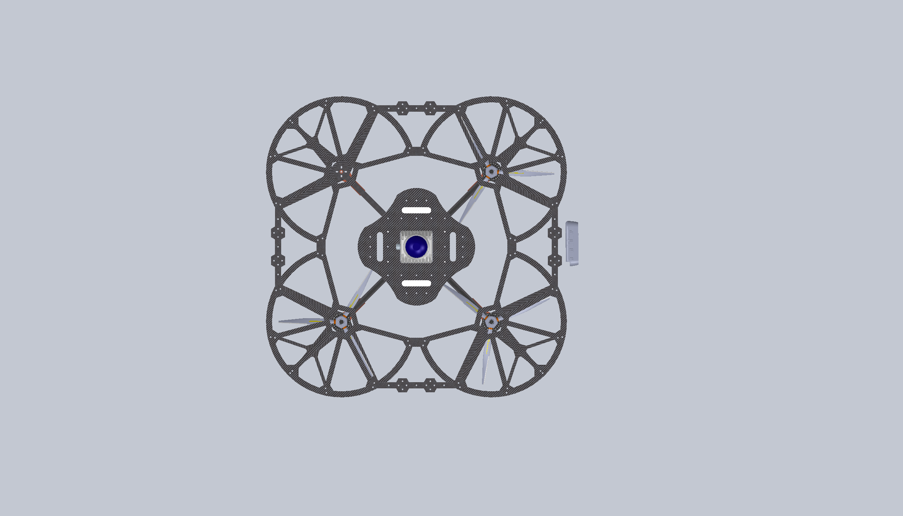
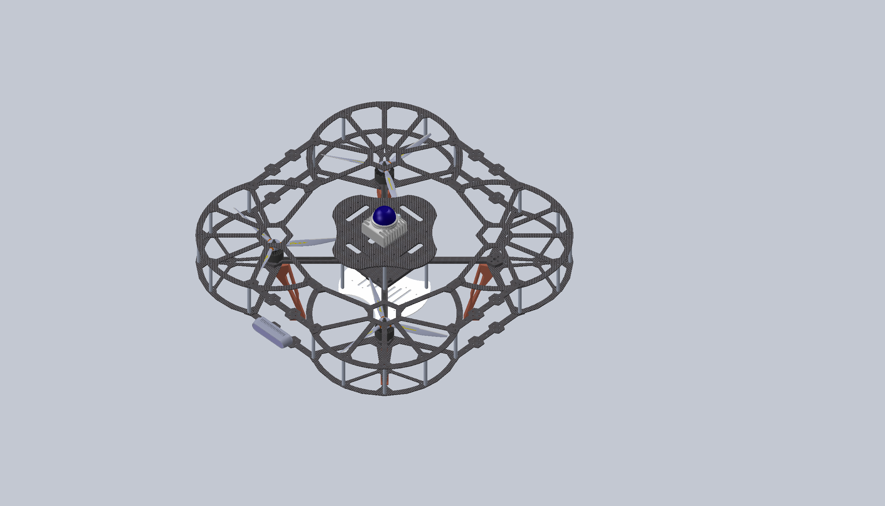
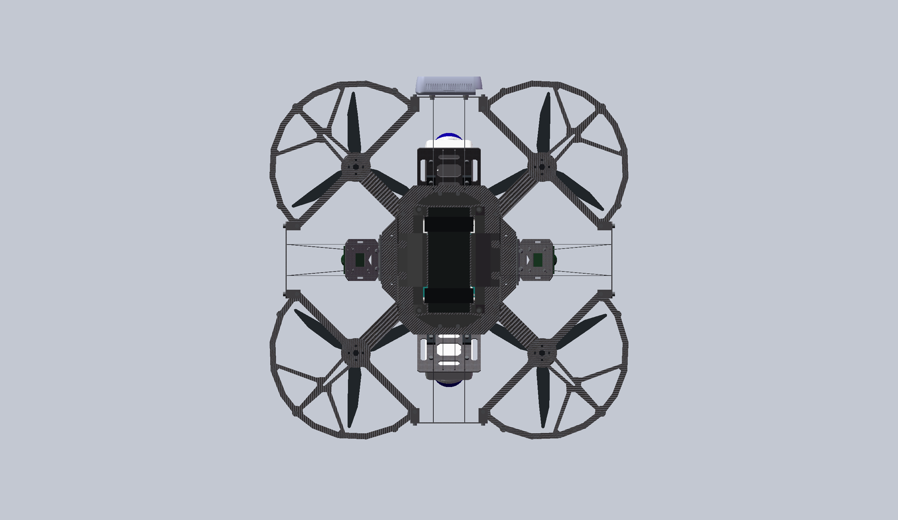
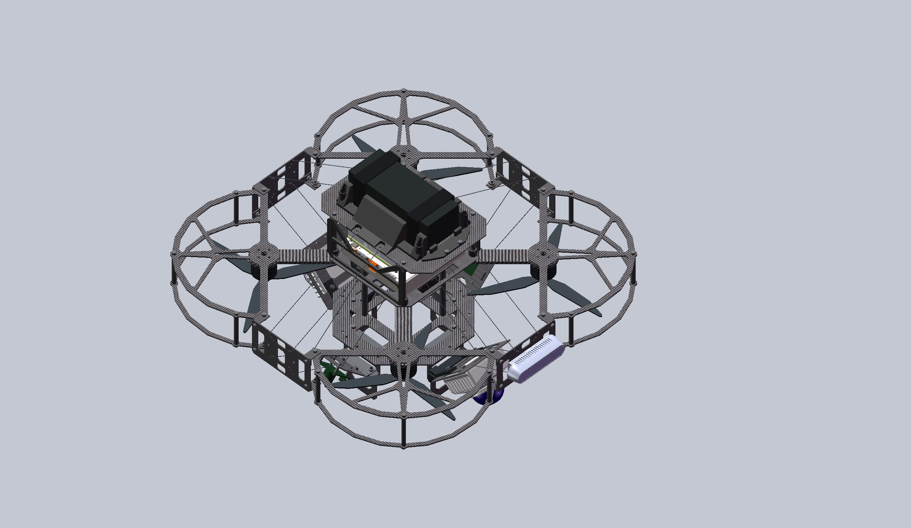

# Quadcopter Models

两代四旋翼无人机的 SolidWorks 机械设计：最早的 **9–10 寸平台**，以及最新的 **KESTREL Q8（红隼）**。

## 9–10 寸平台 · 初代设计

这是一款个人设计研发的400mm轴距四旋翼全保护无人机，适用于全国大学生电子设计竞赛。

以 `9寸桨叶400轴距机架.SLDASM` 为主装配体的早期平台，采用独立机臂、上下中心板、分层桨保与下部设备支撑结构。它也是后续 Q8 在桨保轮廓、辐条过渡和设备安装方面的设计参考。

| 俯视图 | 左上方 45° 视图 |
| :---: | :---: |
|  |  |

主装配体：[9寸桨叶400轴距机架.SLDASM](9-10寸/9寸桨叶400轴距机架.SLDASM)

## KESTREL Q8 · 最新设计

KESTREL Q8 是面向电赛应用的 **8 寸三叶桨四旋翼平台**。以碳纤维板、标准 M3 铝柱和 FDM 打印件构建机架，围绕机载计算、感知设备与检修空间安排布局。

- **动力与桨保**：T-Motor 2810 电机倒置安装；每个旋翼采用约 180° 几何裁切桨保，上下两片通过三根 50 mm M3 铝柱连接，旋翼下方敞开。
- **计算与供电**：Jetson AGX Orin 安装在方形托板上，上层放置 5300 mAh 6S 电池；电池侧鞍和灰色斜切镂空侧罩兼顾造型、接口及散热空间。
- **感知布局**：前后 MID360 朝下 45° 安装，左右设可调角度 USB 相机托板，机头安装 RealSense D435i；飞控使用 Pixhawk 4 参考模型。
- **吊舱与维护**：下部侧板延伸为支脚，底板设检修口；为后续约 80 × 60 mm 路由器保留空间，具体高度与接线布局待实际设备确定。

| 俯视图 | 左上方 45° 视图 |
| :---: | :---: |
|  |  |

主装配体：[Q8_8寸四旋翼.SLDASM](8寸-电赛/KESTREL_Q8/Q8_8寸四旋翼.SLDASM)

## 仓库结构

```text
quadcopter_model/
├── 9-10寸/                    # 初代机架与零件
├── 8寸-电赛/
│   ├── AGENTS.md              # Q8 核心设计规则
│   └── KESTREL_Q8/
│       ├── Q8_8寸四旋翼.SLDASM
│       ├── 零件/
│       ├── 组件/
│       ├── 参考模型/          # 当前整机使用的设备工作副本
│       ├── 材料/
│       └── 制造与交换/
├── MID360/                    # 设备参考模型
├── NVIDIA Jetson AGX Orion/
├── Pixhawk_4/
└── picture/                   # 两架飞机的模型展示图
```

## 打开模型

使用 SolidWorks 2024 或兼容版本，从对应主装配体打开。请完整克隆仓库并保留相对目录结构，避免单独移动零件导致引用丢失。Q8 的有效零件以主装配体实际引用为准；部分文件名保留历史厚度字样，不能据此判断当前实体厚度。

仓库以 SolidWorks 原生文件为主，`.gitignore` 排除 STEP/STP、STL、临时锁文件及本地恢复文件；这些文件可以保留在本机，但不会随 Git 提交。

展示图来自当前 CAD 模型。设计仍在迭代，设备参考外形、质量估算及预留安装空间不代表实物验证结果；打印与加工前应按实际器件核对尺寸和装配关系。
